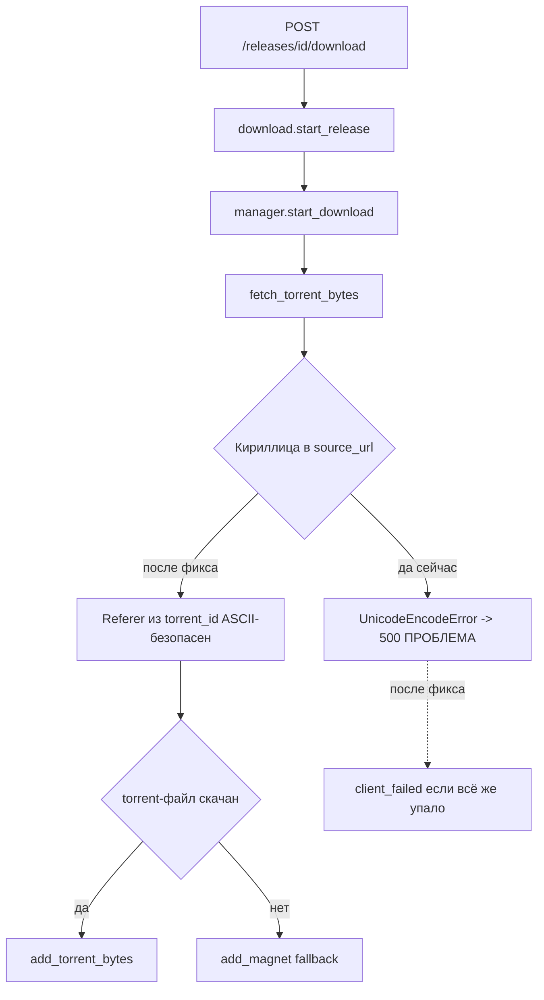

# HTTP 500 при старте загрузки раздачи (POST /releases/{id}/download)

## Симптом

Клиент при нажатии «Слушать» получает:
`Не удалось начать загрузку на сервере: ...`
Сервер отдаёт 500 на `POST /releases/{id}/download`.

## Причина (подтверждена логом)

Файл [`server-part/data/app.log`](server-part/data/app.log:8094):

```
15:12:28 | ERROR | app.api.access | !!! POST /releases/266/download → EXCEPTION за 63.8 ms
Traceback (most recent call last):
  ... app/api/routes/downloads.py:82 in start_release_download
  ... app/catalog/download.py:231 in start_release
  ... app/torrents/manager.py:211 in start_download
  ... app/torrents/manager.py:161 in fetch_torrent_bytes
      async with httpx.AsyncClient( ... )
  ... httpx/_models.py:82 in _normalize_header_value
      return value.encode(encoding or "ascii")
UnicodeEncodeError: 'ascii' codec can't encode character '\xab' in position 64
```

То есть 500 — это **не** «торрент-клиент отказал», а необработанное
исключение при создании HTTP-клиента.

### Механизм

1. В [`fetch_torrent_bytes()`](server-part/app/torrents/manager.py:143) заголовок
   `Referer` устанавливается в сырой `release.source_url`.
2. `source_url` формируется из href раздачи на rutor
   ([`_parse_row()`](server-part/app/scraper/rutor.py:333)) через `urljoin` — **без
   percent-encoding**. Если в пути раздачи есть кириллица/кавычки-«ёлочки»
   (`«` = `\xab`), в БД сохраняется URL с non-ASCII символами.
3. `httpx` кодирует значения заголовков как ASCII
   ([`_normalize_header_value`](server-part/app/torrents/manager.py:161)) и падает
   с `UnicodeEncodeError`.
4. `UnicodeEncodeError` не ловится: в `fetch_torrent_bytes` перехватывается только
   `httpx.HTTPError`, а в [`start()`](server-part/app/catalog/download.py:80) /
   [`start_release()`](server-part/app/catalog/download.py:172) исключение из
   `manager.start_download` не отлавливается вовсе.
5. Исключение всплывает через middleware (который его пере-loggает и `raise`)
   → ASGI-ошибка → клиенту 500 без внятного тела.

Замечание: `_RUTOR_DL_URL` строится по `torrent_id`, поэтому для самого запроса
сырой URL не нужен — «сырым» должен быть только `Referer`.

## Целевой поток (fallback на magnet)



## Изменения

### 1. [`manager.py`](server-part/app/torrents/manager.py:143) — основной фикс

- Строить `Referer` из `torrent_id`, а не из сырого `source_url`:
  `referer = f"{settings.RUTOR_BASE_URL}/torrent/{torrent_id}"` (гарантированно ASCII).
- Расширить перехват в `fetch_torrent_bytes` с `httpx.HTTPError` до `Exception`
  (в т.ч. `UnicodeEncodeError`), логировать и возвращать `None` — это включает
  существующий fallback на magnet (magnet для rutor ASCII-безопасен).
- Опционально: `source_url` при логировании не печатать целиком (кириллица).

### 2. [`rutor.py`](server-part/app/scraper/rutor.py:359) — фикс источника

- В `_parse_row` percent-encoding пути перед сохранением:
  `source_url = urljoin(base, quote(href, safe="/:@!$&'()*+,;=~-._"))`.
- Это исправляет новые записи (легаси-строки в БД остаются, но п.1 их закрывает).

### 3. [`download.py`](server-part/app/catalog/download.py:231) — защитный слой

> **Пересборка БД каталога не требуется.** Главный фикс (п.1) строит
> `Referer` из `torrent_id`, поэтому сырой `source_url` больше не уходит
> в HTTP-заголовок — легаси-записи с кириллицей в БД работают как есть.
> Правка `rutor.py` (п.2) нормализует только новые записи при разборе.

- Обернуть `await manager.start_download(release, save_path)` в `start()` и
  `start_release()` в `try/except Exception` → вернуть
  `DownloadResult(success=False, error_code="client_failed", ...)` с понятным
  сообщением. Гарантирует JSON-ошибку вместо ASGI-креша при любой непредвиденной
  ошибке клиента/сети.

### 4. Тест-скрипт — регрессия

- Проверка: `fetch_torrent_bytes("https://rutor.info/torrent/1106629/viktor-«...»")`
  не бросает исключение (возвращает `None` или байты).
- Проверка: `download.start_release` для раздачи с кириллическим `source_url`
  уходит в magnet-fallback и возвращает `success=True` либо чистый `client_failed`.
- Проверка на реальной записи `release=266` (см. `server-part/test.py`) —
  после фикса в `app.log` нет `UnicodeEncodeError` и `500`.

## Критерии готовности

- `POST /releases/{id}/download` для раздачи с кириллицей/«ёлочками» в URL
  не даёт 500; либо успех (.torrent/magnet), либо корректный `509/500` JSON.
- В `data/app.log` отсутствует `UnicodeEncodeError` и `Exception in ASGI application`
  на этом пути.
- Клиент при успехе получает 202 и продолжает поллинг каталога.
