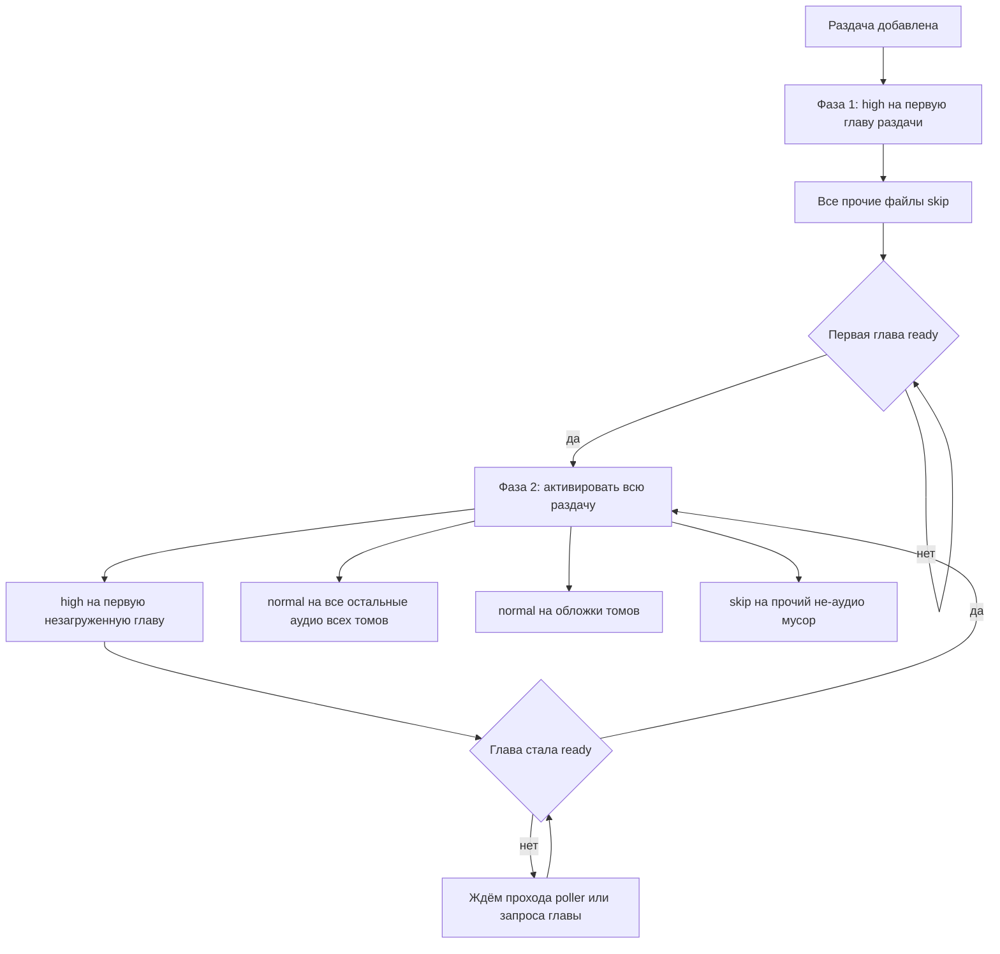

# План: загрузка раздачи — двухфазная схема приоритетов

## Проблема

После готовности первой главы остальные файлы раздачи навсегда остаются в
qBittorrent как «Не загружать» (priority = 0 / skip).

Причина: продвижение `high` считается **по одной книге**, а торрент у раздачи
**общий** (см. [`server-part/app/catalog/download.py`](server-part/app/catalog/download.py:8)).

- [`_advance_high()`](server-part/app/torrents/poller.py:217) принимает `book`,
  а не раздачу; вызывается только для книги, у которой что-то стало `ready`
  ([`poller.py:207`](server-part/app/torrents/poller.py:207)) или только для
  `release.books[0]` при создании глав ([`poller.py:131`](server-part/app/torrents/poller.py:131)).
- Если у текущей книги не осталось незакачанных глав —
  [`poller.py:239`](server-part/app/torrents/poller.py:239) выходит, **не передав
  `high` следующей книге**. Итог: один файл скачан, `high` ни у кого не выставлен,
  всё прочее навсегда в skip.
- Дополнительно [`_apply_initial_priorities()`](server-part/app/torrents/backends/qbittorrent.py:364)
  кладёт обложки в `skip`, хотя строкой выше — в `normal`
  ([`qbittorrent.py:398`](server-part/app/torrents/backends/qbittorrent.py:398)),
  и перезаписывает их, т.к. порядок вызовов `high -> normal -> skip`
  ([`qbittorrent.py:301`](server-part/app/torrents/backends/qbittorrent.py:301)).

## Требуемое поведение (подтверждено пользователем)

Том — это папка с файлами, а не один файл. Приоритет задаётся **на торрент**.

1. **Старт раздачи:** `high` ровно на одну главу — первую по порядку
   (первая книга -> первая глава). Все остальные файлы — skip.
2. **Как только первая глава готова:** начинает качаться **вся раздача сразу**
   (все тома), а не по одной главе:
   - `high` — первая незагруженная глава в порядке раздачи;
   - `normal` — все остальные аудио раздачи + обложки томов;
   - не-аудио/не-картинки — skip.
3. **Дальше, при каждой готовой главе** (в любом томе): `high` переезжает на
   следующую незагруженную главу, остальные остаются `normal`.
4. Фаза 2 — постоянный режим, а не разовый. Продвижение `high` считается
   **по всей раздаче**, а не по книге.

Порядок «от первых к последним» задаётся реляциями, они уже детерминированы:

- [`Release.books`](server-part/app/db/models/release.py:92) — `order_by="Book.ordinal"`;
- [`Book.chapters`](server-part/app/db/models/book.py:81) — `order_by="Chapter.ordinal"`.

Значит порядок раздачи = `по book.ordinal -> по chapter.ordinal`.

## Когда происходит переключение

Актуализация (догнать статусы глав + активировать всю раздачу + перевести `high`
на первую незагруженную главу) — это **один и тот же набор действий**, который
живёт в одной функции `actualize_release(torrent_hash, release)`. У неё ровно две
точки вызова, и обе делают **буквально одно и то же**:

1. **Эндпоинт запроса главы** — [`sync_chapter_status()`](server-part/app/api/streaming.py:92).
   Когда запросили главу 1 и увидели, что файл в торренте уже полон, глава
   помечается `ready` ([`streaming.py:122`](server-part/app/api/streaming.py:122)).
   Эндпоинт **не держит собственной логики приоритетов**: пометив главу, он
   вызывает `actualize_release(chapter.torrent_hash, chapter.release)`.
2. **Очередной проход поллера** — [`poll_downloads()`](server-part/app/torrents/poller.py:48)
   в [`_process_torrent()`](server-part/app/torrents/poller.py:99) вызывает ту же
   `actualize_release(...)` для раздачи. «Проход поллера» = «действия эндпоинта по
   актуализации»: тот же код, тот же результат.

Сценарий, который должен получиться: первая глава `ready` → активируется вся
раздача (все тома) → `high` на 2-ю; когда 2-я `ready` → `high` на первую
незагруженную по раздаче. Сейчас это почти так и задумано в
[`_advance_high()`](server-part/app/torrents/poller.py:217), но считается
**по одной книге**, а должно — **по всей раздаче**.

## Как это выглядит

## Правки по файлам

### 1. Ядро: одна общая функция актуализации раздачи

Требование: проход поллера и действия эндпоинта по актуализации — **это одни и
те же действия**. Поэтому вся логика живёт в одной функции, а обе точки входа
лишь вызывают её.

Разместить в [`server-part/app/torrents/poller.py`](server-part/app/torrents/poller.py:1)
публичную функцию, например `actualize_release(torrent_hash, release)`:

1. Догнать статусы глав по файлам торрента (это уже делает
   [`_update_chapters()`](server-part/app/torrents/poller.py:174), перенести
   туда же, сохранив поведение и `changed`).
2. Определить фазу: если первую по порядку раздачи главу можно считать готовой
   (или уже готовыми стали несколько) — включить фазу 2.
3. В фазе 2 найти **первую незагруженную главу по всей раздаче**: перебор
   `release.books` (по `book.ordinal`), внутри — `book.chapters` (по
   `chapter.ordinal`), беря первую со `status != ready`.
4. Выставить приоритеты одним вызовом
   [`set_file_priorities()`](server-part/app/torrents/manager.py:390):
   `high = [первая незагруженная]`,
   `normal = [все остальные аудио раздачи] + [обложки томов]`,
   `low = [прочий не-аудио мусор]`.
5. Если все главы раздачи `ready` — приоритеты не менять.
6. Идемпотентность: если целевой `high` уже такой же, как в прошлый раз, вызов
   можно пропускать, чтобы не дёргать клиент на каждом проходе.

Сейчас «залипание» даёт [`_apply_high()`](server-part/app/torrents/poller.py:251):
она кладёт остальные аудио в `low` (skip) и считает цель только по одной книге.
Это и есть то, что заменяется.

### 2. Точка входа «проход поллера»

[`_process_torrent()`](server-part/app/torrents/poller.py:99) для каждого торрента
просто вызывает `actualize_release(...)` — без собственной логики приоритетов
и без книжной привязки. Путь создания глав
([`poller.py:131`](server-part/app/torrents/poller.py:131)) тоже ведёт в неё, а не
в отдельную ветку на `release.books[0]`.

### 3. Точка входа «эндпоинт запроса главы»

[`sync_chapter_status()`](server-part/app/api/streaming.py:92) — когда запросили
главу 1 и увидели, что файл в торренте уже полон, глава помечается `ready`
([`streaming.py:122`](server-part/app/api/streaming.py:122)). Здесь же вызывается
та же `actualize_release(torrent_hash, release)` (`release` доступен через
`chapter.release`), чтобы активация остальных файлов не ждала следующего прохода
поллера.

Эндпоинт и поллер вызывают ровно одну функцию — логика не разъедется.

### 4. [`server-part/app/torrents/backends/qbittorrent.py`](server-part/app/torrents/backends/qbittorrent.py:364)

[`_apply_initial_priorities()`](server-part/app/torrents/backends/qbittorrent.py:364)
— это фаза 1 (старт раздачи): `high` на первый аудио, `skip` только на остальные
аудио и прочий не-аудио мусор, **без** картинок; обложки оставить в `normal`.
Сейчас `skip` включает изображения ([`qbittorrent.py:398`](server-part/app/torrents/backends/qbittorrent.py:398))
и перезатирает их, т.к. порядок вызовов `high -> normal -> skip`
([`qbittorrent.py:301`](server-part/app/torrents/backends/qbittorrent.py:301)).

### 5. [`server-part/app/torrents/manager.py`](server-part/app/torrents/manager.py:410)

[`prioritize_for_stream()`](server-part/app/torrents/manager.py:410) — путь
воспроизведения/докачки; должна следовать той же модели фазы 2 (остальные аудио
раздачи — `normal`, не `skip`), либо тоже свестись к вызову ядра.

### 6. Проверка

- Логи [`poller`](server-part/app/torrents/poller.py:1): `high` последовательно
  переходит по всем главам раздачи, без остановки после первой книги.
- В qBittorrent после готовности первой главы: один файл `high`, все остальные
  аудио `normal`, ничего лишнего в «Не загружать».
- Тестовая многотомная раздача скачивается целиком.

### 7. Отдельная задача (не смешивать с приоритетами)

Клиент: [`BookRepository.syncReleases()`](BurkutAudiobooks/app/src/main/java/ru/burkut/audiobooks/data/BookRepository.kt:43)
— добавить `sort = "released_at", order = "desc"` (параметры в
[`ApiService.listReleases()`](BurkutAudiobooks/app/src/main/java/ru/burkut/audiobooks/data/api/ApiService.kt:17)
уже есть). Затем пересборка `gradlew :app:assembleDebug`.
