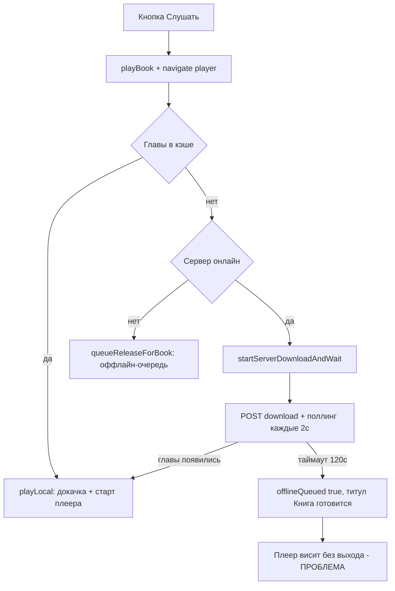
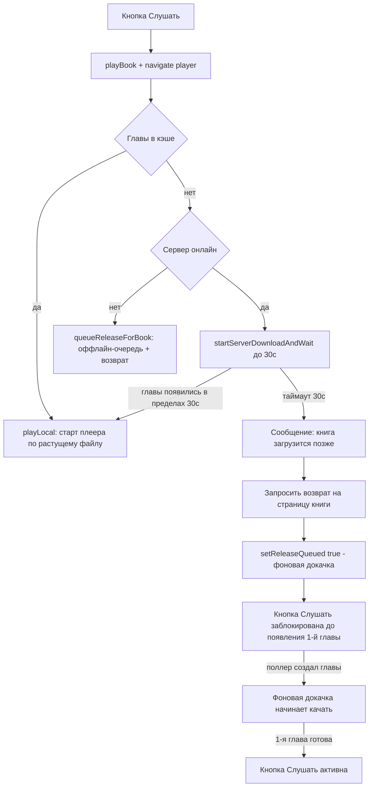

# Возврат из плеера при долгой подготовке книги + блокировка «Слушать»

## Проблема

При нажатии «Слушать» на книге, которая ещё не загружена на сервер (торрент в статусе
`announced` / нет раздающих), клиент переходит на экран плеера и **бесконечно ждёт**
появления потока первой главы:

- [`startServerDownloadAndWait()`](BurkutAudiobooks/app/src/main/java/ru/burkut/audiobooks/player/PlayerViewModel.kt:404)
  ждёт появления глав **до 120 секунд** (`SERVER_PREPARE_TIMEOUT_MS`), опрашивая сервер,
  пока поллер не создаст главы из метаданных торрента;
- если загрузка не начинается (нет сидов/пиров), главы так и не появляются — плеер висит
  с надписью «Подготовка книги на сервере…» и крутилкой, пользователь застрял.

Дополнительно: если книга поставлена в фоновую докачку (`queuedForDevice = true`), а главы
появляются на сервере **позже**, очередь загрузки не подхватывает их автоматически —
[`App.onServerOnline`](BurkutAudiobooks/app/src/main/java/ru/burkut/audiobooks/App.kt:79)
вызывает [`enqueueRelease()`](BurkutAudiobooks/app/src/main/java/ru/burkut/audiobooks/player/DownloadQueue.kt:141)
только один раз в момент появления сервера.

## Требуемое поведение (по уточнению)

1. На экране плеера ждём появления **1-й главы** максимум **30 секунд**.
2. Как только глава появилась — начинаем воспроизведение (растущий `.part`),
   кнопка «Слушать» становится доступной.
3. Если за 30 сек главы не появились:
   - показываем сообщение: «Книга не загружена на сервер, она будет загружена позже»;
   - возвращаемся **на страницу книги** (экран, с которого пришли);
   - ставим раздачу в **фоновую загрузку** (re-query сервера до появления глав);
   - **блокируем кнопку «Слушать»** до готовности 1-й главы (наличие глав в кэше каталога).

## Текущий поток



## Целевой поток



## Изменения

### 1. [`PlayerViewModel.kt`](BurkutAudiobooks/app/src/main/java/ru/burkut/audiobooks/player/PlayerViewModel.kt)

**Состояние и события:**
- Добавить в `PlaybackUiState` флаг `pendingServerLoad: Boolean = false` —
  «книга ещё не загружена на сервер, воспроизведение начнётся позже».
- Добавить в `PlaybackUiState` текст `pendingServerMessage: String? = null` —
  сообщение для Snackbar на плеере.
- Добавить `_requestReturnToBook = MutableStateFlow<Int?>(null)` +
  `val requestReturnToBook: StateFlow<Int?>` — событие «вернись на страницу книги»
  (паттерн уже используется для `requestNextVolume`).

**Логика `startServerDownloadAndWait`:**
- Уменьшить `SERVER_PREPARE_TIMEOUT_MS` с `120_000` до `30_000` (общий бюджет подготовки).
- При таймауте вместо текущего «зависания»:
  ```kotlin
  _state.update {
    it.copy(preparing = false, pendingServerLoad = true,
            pendingServerMessage = "Книга не загружена на сервер. Она будет загружена позже")
  }
  // фоновая докачка: помечаем раздачу queuedForDevice
  val releaseId = repository.getBookEntity(bookId)?.releaseId
  if (releaseId != null) repository.setReleaseQueued(releaseId, true)
  // дублируем сообщение в error, чтобы Snackbar показался и на плеере
  _error.value = "Книга не загружена на сервер. Она будет загружена позже"
  // событие для навигации: вернуться на страницу книги
  _requestReturnToBook.value = bookId
  ```
- Убрать неиспользуемый `offlineQueued` при этом сценарии (либо оставить для оффлайн-ветки).

**`ensureChaptersDownloaded` / общий бюджет 30 сек:**
- Уменьшить `CHAPTER_READY_TIMEOUT_MS` с `60_000` до `15_000` — это ожидание файла
  стартовой главы внутри плеерного флоу; 30-секундный бюджет пользователя должен
  покрывать весь подготовительный цикл (появление главы в каталоге + создание файла).
- В [`playLocal`](BurkutAudiobooks/app/src/main/java/ru/burkut/audiobooks/player/PlayerViewModel.kt:463)
  передавать в `ensureChaptersDownloaded` дедлайн `now + 30_000` и проверять его в цикле
  ожидания файла — при исчерпании бюджета выходить на тот же сценарий «загрузится позже».
- Ветка таймаута `ensureChaptersDownloaded` тоже выставлять `pendingServerLoad`,
  `_error.value` и `_requestReturnToBook` (глава появилась, но файл не создан за бюджет —
  по сути то же «загрузится позже»).

**`queueReleaseForBook` (оффлайн):** оставить поведение, но установить
`pendingServerMessage = "Сервер не доступен, загрузка будет выполнена при появлении подключения"`
и тоже `_requestReturnToBook`.

### 2. Фоновая докачка появившихся глав

Нужно, чтобы вновь созданные поллером главы попадали в `DownloadQueue`.

**Вариант: циклический `enqueueQueued()` в [`App.kt`](BurkutAudiobooks/app/src/main/java/ru/burkut/audiobooks/App.kt)**

- Добавить в `DownloadQueue` метод:
  ```kotlin
  /** Пройтись по раздачам в очереди и добавить недостающие главы. */
  suspend fun enqueueQueued(baseUrl: String)
  ```
  Логика: `repository.getQueuedReleases()` → для каждой `enqueueRelease(releaseId, baseUrl)`
  (метод уже существует и идемпотентен по chapterId — `activeTasks.putIfAbsent`).
- В `App` после `serverMonitor.onServerOnline` запускать **цикл**:
  ```kotlin
  serverMonitor.onServerOnline = { baseUrl ->
      appScope.launch {
          downloadQueue.setServerAvailable(true)
          while (true) {
              downloadQueue.enqueueQueued(baseUrl)
              delay(EQUEUE_POLL_MS) // например 30_000
          }
      }
  }
  ```
- Учесть остановку цикла при оффлайне: убивать `Job` при `ServerAvailability.Offline`
  (подписка на `serverMonitor.availability` в `App`) либо оставить цикл — `enqueueQueued`
  будет быстро идти впустую (но `enqueueRelease` берёт главы из кэша, повторная постановка
  идемпотентна, лишних запросов к серверу не делает при пустом кэше). Выбираем вариант с
  отменой по Offline, чтобы не грелся сетевой стек.

Эффект: книга, помеченная `queuedForDevice` (наш сценарий «загрузится позже»), будет
автоматически докачана, как только поллер создаст главы — пользователь просто получит
уведомление и разблокированную кнопку.

### 3. UI: блокировка кнопки «Слушать»

**Критерий разблокировки:** в локальном кэше есть хотя бы одна глава книги
(`state.chapters.isNotEmpty()`), т.е. поллер создал главы на сервере и они синхронизированы.

**Изменения:**

- [`BookDetailScreen.kt`](BurkutAudiobooks/app/src/main/java/ru/burkut/audiobooks/ui/detail/BookDetailScreen.kt):
  - Вычислить `val canPlay = state.chapters.isNotEmpty()`.
  - Кнопка «Слушать»:
    ```kotlin
    Button(onClick = onPlay, enabled = canPlay) { ... }
    ```
  - Когда `!canPlay && (state.queued || state.serverStatus == announced)` — показывать
    рядом подпись «Загрузка на сервере…» / «Прослушивание станет доступным после
    готовности первой главы».
  - Когда `state.queued && !canPlay` — подсказка «Книга будет загружена позже»
    (существующий блок для оффлайна расширить на общий случай очереди).
- `BookDetailUiState` не требует новых полей — `chapters` уже наблюдается через
  `observeChapters` (Flow), кнопка разблокируется автоматически при синке.

### 4. Навигация: возврат на страницу книги

**Изменения в [`MainActivity.kt`](BurkutAudiobooks/app/src/main/java/ru/burkut/audiobooks/ui/MainActivity.kt):**

- Коллектить `playerVm.requestReturnToBook`:
  ```kotlin
  val returnToBook by playerVm.requestReturnToBook.collectAsState()
  LaunchedEffect(returnToBook) {
      returnToBook?.let { bookId ->
          playerVm.dismissReturnToBook()
          navController.popBackStack() // плеер -> страница книги
      }
  }
  ```
- Открытие плеера в `onPlay` оставить как есть (`navigate("player")`), т.к. сообщение
  покажется на плеере перед возвратом.

**Изменения в [`PlayerScreen.kt`](BurkutAudiobooks/app/src/main/java/ru/burkut/audiobooks/ui/player/PlayerScreen.kt):**

- Когда `state.pendingServerLoad && state.pendingServerMessage != null` — показать
  Snackbar с сообщением (существующий механизм `error`/`LaunchedEffect` можно переиспользовать:
  выставить `vm.error` при таймауте, чтобы Snackbar показался на плеере, а затем
  `popBackStack`).

Итоговый UX: нажали «Слушать» → плеер с крутилкой до 30 сек → сообщение в Snackbar →
автовозврат на страницу книги → кнопка «Слушать» заблокирована с пояснением → фоновая
загрузка в очереди → появилась 1-я глава → кнопка активна, можно слушать.

## Затрагиваемые файлы

| Файл | Изменение |
|---|---|
| [`PlayerViewModel.kt`](BurkutAudiobooks/app/src/main/java/ru/burkut/audiobooks/player/PlayerViewModel.kt) | таймауты 30с, `pendingServerLoad`, `requestReturnToBook`, сообщения |
| [`App.kt`](BurkutAudiobooks/app/src/main/java/ru/burkut/audiobooks/App.kt) | цикл `enqueueQueued` пока сервер онлайн |
| [`DownloadQueue.kt`](BurkutAudiobooks/app/src/main/java/ru/burkut/audiobooks/player/DownloadQueue.kt) | метод `enqueueQueued(baseUrl)` |
| [`MainActivity.kt`](BurkutAudiobooks/app/src/main/java/ru/burkut/audiobooks/ui/MainActivity.kt) | коллект `requestReturnToBook` → `popBackStack` |
| [`PlayerScreen.kt`](BurkutAudiobooks/app/src/main/java/ru/burkut/audiobooks/ui/player/PlayerScreen.kt) | Snackbar с сообщением о фоновой загрузке |
| [`BookDetailScreen.kt`](BurkutAudiobooks/app/src/main/java/ru/burkut/audiobooks/ui/detail/BookDetailScreen.kt) | `enabled = chapters.isNotEmpty()` + подпись «загрузится позже» |

Серверная часть **не меняется** — сервер уже корректно отдаёт 409 на неготовую главу,
поллер создаёт главы по мере появления метаданных.

## Риски и замечания

- `DownloadQueue.downloadChapter` при 409 возвращает задачу в очередь с `RETRY_DELAY_MS=3с` —
  это уже работает для неготовых глав; повторная постановка идемпотентна по chapterId.
- Пока глава не появилась, `enqueueRelease` не добавит ничего (главы пустые) — поэтому
  критичен именно **циклический** пересмотр очереди из п.2.
- `BookDetailViewModel.refresh()` нужно вызывать периодически или полагаться на Flow
  `observeChapters` — при синке карточки из `PlayerViewModel`/монитора главы приедут в
  кэш, и кнопка разблокируется без ручного refresh.