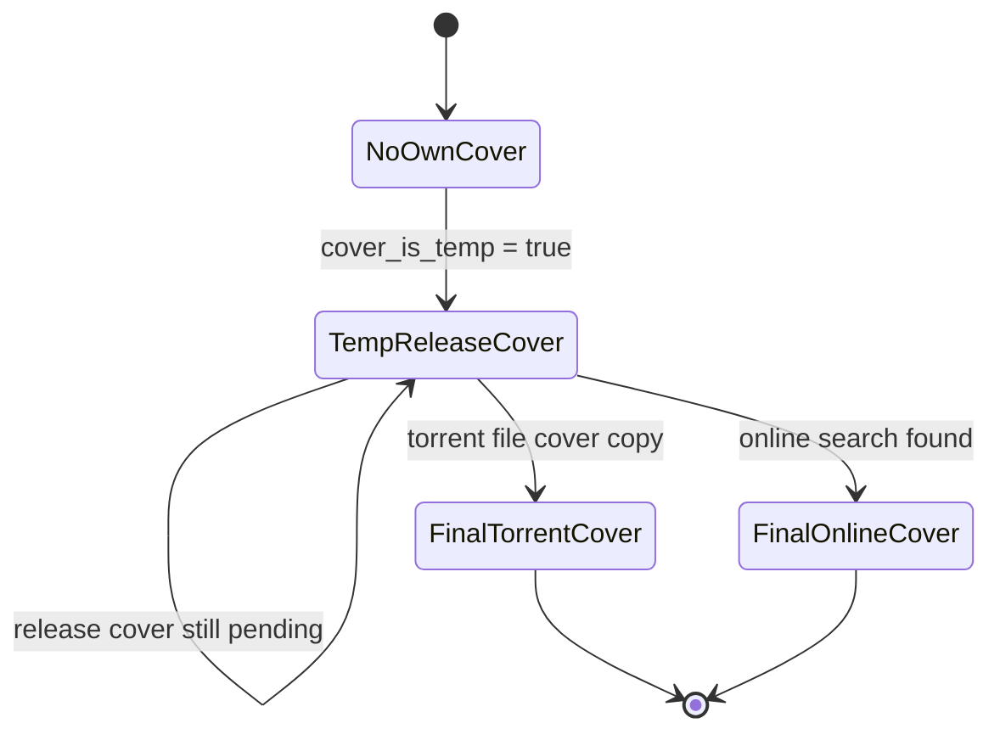

# План: обложка на странице плеера (release-cover fallback + поллинг обложки)

## Проблема
На странице плеера обложка всегда отсутствует. Причины, найденные при разборе:

1. **Сервер не отдаёт обложку раздачи как фолбэк.** В
   [`_upsert_book_from_group()`](server-part/app/catalog/ingest.py:459) для
   однократной (single-volume) раздачи без своей обложки ставится
   `book.cover_is_temp = False` (строки 510-515). Поэтому
   [`get_book_cover()`](server-part/app/api/routes/covers.py:47) не заходит в
   ветку фолбэка `book.cover_is_temp and not book.cover_cache_path` и отдаёт
   placeholder вместо обложки карточки раздачи.
   То же в [`_apply_temp_cover()`](server-part/app/catalog/download.py:67):
   `book.cover_is_temp = _is_multi_release(release)`.

2. **Клиент выставляет `artworkUri` один раз.** В
   [`playLocal()`](BurkutAudiobooks/app/src/main/java/ru/burkut/audiobooks/player/PlayerViewModel.kt:654)
   `MediaMetadata.artworkUri` задаётся единожды из `book.coverUrl`.
   [`snapshot()`](BurkutAudiobooks/app/src/main/java/ru/burkut/audiobooks/player/PlayerViewModel.kt:199)
   каждые 400 мс перечитывает `artUri` из `mediaMetadata.artworkUri` и не имеет
   цикла опроса. Поэтому поздняя финальная обложка никогда не появляется.

## Целевое поведение (по запросу)
Цепочка получения обложки на сервере:
1. **умолчание** — обложка карточки раздачи (Release card);
2. если её нет — **поиск в интернете** (для раздачи);
3. затем, если картинка есть **в файлах торрента** — она **заменяет** прежнюю.

Клиент получает сначала обложку по умолчанию **с признаком переопределения**
(`cover_is_temp = true`), затем **либо новую, либо со снятым признаком**.
То есть клиент **опрашивает обложку, пока не получит финальную версию**
(`cover_is_temp = false`).

Признак `cover_is_temp = true` означает: «книга показывает не свою обложку
(обложку раздачи / из интернета), финальной ещё нет».

## Диаграмма состояний обложки книги

## Изменения на сервере

### 1. Всегда включать фолбэк на обложку раздачи
- [`ingest.py::_upsert_book_from_group()`](server-part/app/catalog/ingest.py:459):
  убрать ветвление `if is_multi` — книга без своей обложки всегда получает
  `book.cover_is_temp = True`.
- [`download.py::_apply_temp_cover()`](server-part/app/catalog/download.py:67):
  убрать `_is_multi_release(release)` и всегда ставить `True`, если у книги нет
  своей обложки. Функцию `_is_multi_release` либо оставить для других нужд,
  либо удалить, если больше не используется.

### 2. Сохранить существующее поведение онлайн-поиска книг
- [`poller.py::_book_needs_online_cover()`](server-part/app/torrents/poller.py:437):
  понижаемый онлайн-поиск обложки по книге оставить только для многотомных
  раздач (`len(release.books) > 1`), чтобы не запускать его для каждой
  однократной книги. (Обложка раздачи при отсутствии ищется на уровне
  `_ensure_cover`.)

### 3. Проверить отдачу временной обложки
- [`covers.py::get_book_cover()`](server-part/app/api/routes/covers.py:47):
  ветка `book.cover_is_temp and not book.cover_cache_path` отдаёт обложку
  раздачи с `X-Cover-Temp: true` и `Cache-Control: no-cache`. Убедиться, что
  флаг теперь выставляется для всех книг без своей обложки.

### 4. Гарантировать обложку раздачи
- [`ingest.py::_ensure_cover()`](server-part/app/catalog/ingest.py:310) уже
  делает tracker → интернет. Проверить, что шедулер/повторный ingest
  дожимает отсутствующую обложку раздачи.

### 5. Разрешить лёгкий HEAD-запрос к обложке (сигнал «финал?»)
Клиенту не нужно тянуть всю карточку книги — признак `cover_is_temp` уже
отдаётся заголовком `X-Cover-Temp` от `/books/{id}/cover`. Чтобы опрашивать
его без скачивания самого изображения:
- В [`covers.py`](server-part/app/api/routes/covers.py) зарегистрировать тот же
  обработчик `get_book_cover` и для `HEAD`: заменить
  `@router.get("/books/{book_id}/cover")` на
  `@router.api_route("/books/{book_id}/cover", methods=["GET", "HEAD"])`.
  Тело ответа для `HEAD` не отправляется (Starlette/FileResponse учитывают
  метод), но заголовки (`X-Cover-Temp`, `Cache-Control`, `ETag`) отдаются.
- Проверить, что ветка `_serve_temp_release_cover()` (и заглушка в ней)
  присутствует во всех состояниях, пока обложка не финальна.

## Изменения в клиенте (Android)

### 6. Отдельный источник `artUri` + опрос именно обложки
[`PlayerViewModel.kt`](BurkutAudiobooks/app/src/main/java/ru/burkut/audiobooks/player/PlayerViewModel.kt)
- Добавить `private var currentCoverUrl: String?` и `private var coverPollJob: Job?`.
- [`snapshot()`](BurkutAudiobooks/app/src/main/java/ru/burkut/audiobooks/player/PlayerViewModel.kt:199):
  `artUri = currentCoverUrl ?: item?.mediaMetadata?.artworkUri?.toString()` —
  чтобы 400-мс снапшот не перетирал опрошенную обложку.
- [`playLocal()`](BurkutAudiobooks/app/src/main/java/ru/burkut/audiobooks/player/PlayerViewModel.kt:654):
  инициализировать `currentCoverUrl = book?.coverUrl`; если
  `book?.coverIsTemp == true`, запустить корутину опроса.

### 7. Опрос обложки (а не всей книги)
- Периодически (например, каждые 5 с), пока не истёк общий таймаут, посылать
  **HEAD** `GET /books/{id}/cover` и читать заголовок `X-Cover-Temp`:
  - заголовок `true` → обложка ещё временная: обновить `currentCoverUrl`
    тем же URL с cache-busting nonce (например, `?v=<timestamp>`), чтобы
    Coil перечитал картинку, и продолжить опрос;
  - заголовка нет (или не `true`) → финал: подставить финальный URL с nonce,
    остановить опрос;
  - ошибка сети → не падать, попробовать в следующей итерации.
- Никакого JSON карточки не запрашиваем: только обложку (заголовки).

### 8. Слой данных
- [`ApiService.kt`](BurkutAudiobooks/app/src/main/java/ru/burkut/audiobooks/data/api/ApiService.kt):
  добавить
  `@HEAD("books/{book_id}/cover") suspend fun headCover(@Path("book_id") bookId: Int): retrofit2.Response<okhttp3.ResponseBody>`
  (заголовки читаем через `resp.headers()`).
- [`BookRepository.kt`](BurkutAudiobooks/app/src/main/java/ru/burkut/audiobooks/data/BookRepository.kt):
  добавить хелпер `suspend fun coverIsTemp(bookId: Int): Boolean?` —
  `null` при ошибке/недоступности, `true`/`false` по заголовку.

### 9. Обновление UI и (опционально) уведомления
- `state.artUri` подхватывается
  [`PlayerScreen.kt`](BurkutAudiobooks/app/src/main/java/ru/burkut/audiobooks/ui/player/PlayerScreen.kt:121)
  и [`MiniPlayer.kt`](BurkutAudiobooks/app/src/main/java/ru/burkut/audiobooks/ui/components/MiniPlayer.kt:48)
  — дополнительных правок не требуется.
- Опционально: обновлять `MediaMetadata.artworkUri` для уведомления
  (через `MediaController`) — обсуждается отдельно.

### 10. Остановка опроса
- Отменять `coverPollJob` при `onCleared()`, при смене книги в
  [`playLocal()`](BurkutAudiobooks/app/src/main/java/ru/burkut/audiobooks/player/PlayerViewModel.kt:654)
  и при выходе из плеера.

## Проверка
- Сервер: `GET /books/{id}/cover` для однократной книги без своей обложки
  возвращает `200` + `X-Cover-Temp: true` и картинку раздачи (а не placeholder).
- `HEAD /books/{id}/cover` возвращает те же заголовки без тела.
- После появления обложки раздачи/онлайн/торрента флаг снимается, отдаётся
  финальная картинка с обычным кэшем.
- Клиент: открыть плеер — сначала видна обложка раздачи, после получения
  финальной она обновляется автоматически без перезапуска воспроизведения.
