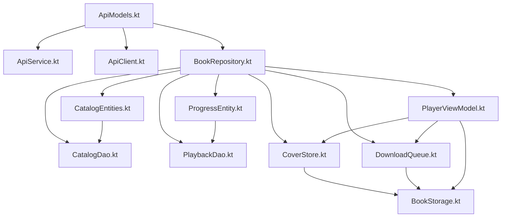

# Рефакторинг клиента: Book-centric catalog

## Мотивация

Серверная часть перешла на книго-центричную модель. Ранее книги были вложены в
раздачи и имели числовой `id`. Теперь:

- **Книга (Book)** — первичная единица каталога; её идентификатор — SHA256-хэш
  (`String`).
- **Раздача (Release)** — остаётся как карточка, но не является основой каталога.
- Эндпоинт `/books` возвращает список книг (томов), каждая со своим хэшем.
- Эндпоинт `/releases` возвращает карточки раздач с вложенными книгами.

## Сводка изменений API (относительно текущего клиента)

| Сущность | Поле | Было | Стало |
|---|---|---|---|
| `BookOut.id` | | `Int` | `String` (хэш) |
| `BookDetailOut.id` | | `Int` | `String` |
| `ReleaseBookOut.id` | | `Int` | `String` |
| `ReleaseBookDetailOut.id` | | `Int` | `String` |
| `DownloadStartedOut.book_id` | | `Int?` | `String?` |
| `DownloadStoppedOut.book_id` | | `Int` | `String` |
| `DownloadStatusOut` | | `book_id: Int` | `book_hash: String` (переименовано!) |
| `DownloadStatusOut.release_id` | | нет | `Int?` |
| `BookDeletedOut.book_id` | | `Int` | `String` |
| `PriorityOut.book_id` | | `Int` | `String` |
| `ReleaseBookOut` / `ReleaseBookDetailOut` | | `is_provisional` нет | `is_provisional: Boolean` |
| | | `cover_is_temp` нет | `cover_is_temp: Boolean` |
| `BookOut` | | `is_provisional` нет | `is_provisional: Boolean` |

Все пути `/books/{book_id}` теперь используют строковый хэш вместо числа.

## План рефакторинга

### Этап 1. API-модели (`ApiModels.kt`)

Изменить типы:

- `ReleaseBookOut.id: Int` → `id: String`
- `ReleaseBookDetailOut.id: Int` → `id: String`
- `BookOut.id: Int` → `id: String`
- `BookDetailOut.id: Int` → `id: String`
- `DownloadStartedOut.book_id: Int?` → `book_id: String?`
- `DownloadStoppedOut.book_id: Int` → `book_id: String`
- `DownloadStatusOut`: `book_id: Int` → `book_hash: String` (поле переименовано!)
- Добавить `release_id: Int?` в `DownloadStatusOut`
- `BookDeletedOut.book_id: Int` → `book_id: String`
- `PriorityOut.book_id: Int` → `book_id: String`

Добавить поля:

- `is_provisional: Boolean = false` в `ReleaseBookOut`, `ReleaseBookDetailOut`, `BookOut`, `BookDetailOut`
- `cover_is_temp: Boolean = false` — уже есть во многих, проверить наличие

### Этап 2. Room-сущности (`CatalogEntities.kt`, `ProgressEntity.kt`) + миграция

**`BookEntity`**:
- `id: Int` → `id: String` (`@PrimaryKey`)
- `releaseId: Int` — остаётся `Int` (release_id на сервере — integer)
- Добавить `isProvisional: Boolean = false`
- Добавить `coverIsTemp: Boolean` — уже есть
- Удалить `localTotalBytes: Long` — не используется

**`ChapterEntity`**:
- `bookId: Int` → `bookId: String`

**`ProgressEntity`**:
- `bookId: Int` → `bookId: String`

**Миграция БД**: версия 5 → 6
- Изменить тип `id` в таблице `books` с `INTEGER` на `TEXT`
- Изменить тип `bookId` в таблице `chapters` с `INTEGER` на `TEXT`
- Изменить тип `bookId` в таблице `playback_progress` с `INTEGER` на `TEXT`
- Все существующие числовые ID станут строковыми — преобразование: `CAST(id AS TEXT)`

> **Внимание**: Миграция SQLite не поддерживает `ALTER COLUMN`. Нужно создавать
> новые таблицы, копировать данные с преобразованием, удалять старые таблицы.
> Либо использовать `fallbackToDestructiveMigration()` — проще, но сбросит кэш.

### Этап 3. Room DAO (`CatalogDao.kt`, `PlaybackDao.kt`)

- Все `Int` параметры для book ID заменить на `String`
- `getBook(id: Int)` → `getBook(id: String)`
- `observeBooks(releaseId: Int)` — остаётся `Int` (release_id integer)
- `upsertBook(entity: BookEntity)` — тип поменяется через сущность
- `getChapters(bookId: Int)` → `getChapters(bookId: String)`
- Аналогично все методы, принимающие bookId

### Этап 4. `ApiService.kt`

- В путях `/books/{book_id}` → `/books/{book_hash}`, параметры `@Path("book_id")` → `@Path("book_hash")`
- Тип параметров: `Int` → `String`
- `startReleaseDownload`: убрать `@Query("book_id") bookId: Int?` — его больше нет в API
- `@GET("books/{book_id}/cover")` → `@GET("books/{book_hash}/cover")` и т.д.

### Этап 5. `ApiClient.kt` — JSON-адаптеры

- Все адаптеры в `GeneratedAdapterFactory` подхватят изменения типов автоматически (сгенерированные Moshi-адаптеры), так как сами классы DTO меняются.
- Дополнительно зарегистрировать новые адаптеры, если появятся.

### Этап 6. `BookRepository.kt`

- Все `bookId: Int` → `bookId: String` во всех методах
- `getReleaseDetailForBook(bookId: Int, ...)` → `bookId: String`
- `getBookEntity(id: Int)` → `id: String`
- `getChapters(bookId: Int)` → `bookId: String`
- `observeChapters(bookId: Int)` → `bookId: String`
- Мапперы `toEntity()` — обновить под новые типы
- `coverIsTemp(bookId: Int)` → `bookId: String`

### Этап 7. `BookStorage.kt`

- Структура директорий: `filesDir/books/{bookId}/` — bookId теперь строка (хэш)
- Все `bookId: Int` → `bookId: String`
- `releaseCoverFile(releaseId: Int)` — остаётся `Int`

### Этап 8. `CoverStore.kt`

- `cachedBookCover(bookId: Int)` → `bookId: String`
- `ensureBookCover(bookId: Int, ...)` → `bookId: String`
- `warmUpReadyBooks()` — использует `book.id: String`
- `getCover(bookId: Int)` в вызове API → `getCover(bookHash: String)`

### Этап 9. `DownloadQueue.kt`

- `bookId: Int` → `bookId: String` во всех data-классах (`DownloadTask`, `ChapterDownloadSpec`)
- `DownloadQueueState.currentBookId: Int?` → `String?`
- URL для stream: `/books/${book.id}/stream/${ch.id}` → `/books/${bookHash}/stream/${ch.id}`
- `enqueueRelease`: `repository.getBooksByRelease(releaseId, excludeBookId = -1)` — убрать `excludeBookId` или изменить под `String`

### Этап 10. `PlayerViewModel.kt`

Самое объёмное изменение. Переход с `Int` на `String` для bookId:

- `parseMediaId()` — формат `mediaId` меняется: `"bookId:chapterOrdinal"` → `"bookHash:chapterOrdinal"`
- `chapterMediaId(bookId: Int, chapterOrdinal: Int)` → `bookHash: String`
- `playBook(bookId: Int)` → `playBook(bookHash: String)`
- `playChapter(bookId: Int, chapterOrdinal: Int)` → `bookHash: String`
- `playRelease(releaseId: Int)` — остаётся `Int`
- `startServerDownloadAndWait(bookId: Int, ...)` → `bookHash: String`
- `playLocal(bookId: Int, ...)` → `bookHash: String`
- `ensureChaptersDownloaded(bookId: Int, ...)` → `bookHash: String`
- URL для stream: `/books/$bookHash/stream/${ch.id}`
- `startCoverPolling(bookId: Int, ...)` → `bookHash: String`
- `applyBookCover(bookId: Int)` → `bookHash: String`
- `playerScreenBookId: Int?` → `String?`
- `queueReleaseForBook(bookId: Int)` → `bookHash: String`
- `maybeRequestNextVolume()` — использует `book.releaseId` (Int) и `book.ordinal`
- `alternativeBookWithChapters(bookId: Int)` → `bookHash: String`
- `getBooksByRelease(releaseId, excludeBookId: Int)` → `excludeBookHash: String`
- `onPlayerScreenOpened()` / `onPlayerScreenClosed()` — используют `playerScreenBookId`

### Этап 10а. Гейт готовности воспроизведения (не открывать плеер, если глава не готова)

Требование пользователя: **не показывать экран плеера, если хоть одна глава книги
не готова**. Вместо этого поверх карточки книги показывается **окно ожидания
со статусом**, и по истечении таймаута **30 с** возврат на карточку книги.

Как это реализуется в текущем потоке `playBook → prepareAndPlay → playLocal`
(см. `startServerDownloadAndWait` и `ensureChaptersDownloaded`):

1. **Сигнал готовности** — добавить в `PlaybackUiState` (или отдельный
   `StateFlow<BookPlayState>`):
   ```kotlin
   data class PlayRequestUiState(
       val requestedBookHash: String? = null, // какую книгу просили играть
       val waiting: Boolean = false,          // идёт ожидание готовности глав
       val status: String? = null,            // текст статуса в окне ожидания
   )
   ```
   - `waiting = true` выставляется в `startPrepare(...)` — сразу после запроса
     на воспроизведение (локального или с сервера).
   - `status` обновляется по ходу подготовки: «Подготовка книги на сервере…»,
     «Глава N/M готова…», «Идёт докачка…» и т.п.
   - `waiting = false` — как только `playLocal` выставил `hasMedia = true`
     (файл стартовой главы готов) — это и есть «плеер реально стартовал».

2. **Таймаут 30 с** — в `startPrepare` (или обёртке `playBook`/`playChapter`/
   `playRelease`) запустить параллельный таймер:
   ```kotlin
   prepareJob = viewModelScope.launch {
       // ожидание готовности глав
       val ready = waitForChaptersReady(bookHash, timeoutMs = 30_000)
       if (!ready) {
           // таймаут — возврат на карточку книги
           _playRequest.value = PlayRequestUiState(bookHash, waiting = false, status = null)
           cancelPrepareWithMessage("Книга не готова за 30 с — вернитесь позже")
       }
   }
   ```

3. **Согласование с `ensureChaptersDownloaded`/`startServerDownloadAndWait`**:
   - Эти методы уже ждут готовности стартовой главы. Задача — на время
     ожидания держать `waiting = true` и транслировать статус в окно ожидания.
   - Как только появился реальный `MediaItem` (в `snapshot()` `hasMedia=true`
     и `preparing`/`waiting` снят) — сигнализируем «плеер готов».

### Этап 10б. Принятие решения о старте

В `prepareAndPlay(...)` после `playLocal(...)` — в точке, где `hasMedia = true`,
выставить сигнал готовности:
```kotlin
_playRequest.value = PlayRequestUiState(bookHash, waiting = false, status = null)
// Плеер готов — MainActivity по этому сигналу откроет экран плеера.
```
Если главы так и не готовы за 30 с (`preparing`/`waiting` сняты, `hasMedia=false`)
— сигнал готовности НЕ приходит; `MainActivity` остаётся на карточке книги.

### Этап 11. UI-экраны

**Ключевое изменение: в каталоге только книги, карточки раздач не используются.**

**`CatalogScreen.kt`** (переход на книго-центричный каталог):
- `onOpenRelease: (Int) -> Unit` → удалить; вместо него `onOpenBook: (String) -> Unit`
- `ReleaseCard` → заменить на `BookCard`, отображающий:
  - Обложка (`coverUrl`)
  - Название книги (`title`)
  - Автор и чтец (`author` / `narrator`)
  - Год (`year`)
  - Длительность (`totalDurationSec`)
  - Статус готовности (`status`, `chaptersReady` / `chaptersCount`)
- `ReleaseEntity` → заменить на `BookEntity` для отрисовки карточек
- Фильтры (рубрики, серии) — перенести на `BookEntity`: рубрики хранятся как
  `rubrics: String?` (join-строка с переносами), серии — `seriesId`/`seriesTitle`
- Заголовок: «Раздачи» → «Книги» (или «Каталог»)

**`BookDetailScreen.kt`**:
- `bookId: Int` → `bookHash: String`
- `onPlay: (String)` — тип параметра меняется на `String`
- Убрать прямой вызов `navController.navigate("player")` — навигацию на плеер
  теперь выполняет `MainActivity` по сигналу готовности (этап 10а)
- Добавить **окно ожидания** — Composable поверх карточки книги, показывается при
  `playRequest.waiting == true && playRequest.requestedBookHash == bookHash`:
  - `CircularProgressIndicator` (индикатор загрузки)
  - Текст статуса из `playRequest.status` (например, «Подготовка книги на сервере…»,
    «Ожидание главы 3/12…», «Идёт докачка…»)
  - Кнопка «Отмена» — `playerVm.cancelPlayRequest()` + закрытие окна, возврат к карте
  - По таймауту 30 с окно закрывается, плеер НЕ открывается
- URL обложки формируется через `book.coverUrl` (уже строка)

**`ReleaseDetailScreen.kt`** и **`ReleaseDetailViewModel.kt`**:
- Удалить целиком — в книго-центричном UI нет экрана раздачи
- Вся навигация к книгам идёт напрямую из каталога
- `onPlayRelease` больше не нужен — воспроизведение начинается с конкретной книги

**`PlayerScreen.kt`** — нужно проверить, использует ли bookId как Int

**`MainActivity.kt`**:
- Навигация `"book/{bookHash}"` — парсинг как `String` (без `toIntOrNull()`)
- Удалить `composable("release/{releaseId}")` — этот маршрут больше не нужен
- `onPlay = { id -> playerVm.playBook(id) }` — `id: String`; **убрать** немедленный
  `navController.navigate("player")` — плеер открывается ТОЛЬКО по сигналу готовности
- Каталог вызывает `onOpenBook = { id -> navController.navigate("book/$id") }`
- Добавить подписку на сигнал готовности:
  ```kotlin
  val playRequest by playerVm.playRequest.collectAsState()
  LaunchedEffect(playRequest) {
      val ready = playRequest?.waiting == false &&
          (playRequest?.requestedBookHash != null)
      if (ready) navController.navigate("player")
  }
  ```
- `onOpenBook = { id -> navController.navigate("book/$id") }` — `id: String`
- `onPlayRelease` удалён

### Этап 12. ViewModel'ы

**`CatalogViewModel.kt`** (переход на книго-центричный каталог):
- `CatalogUiState.releases: List<ReleaseEntity>` → `books: List<BookEntity>`
- `observeReleases()` → `observeAllBooks()` — каталог читает книги напрямую
- `setSeries(seriesId: Int?)` — остаётся `Int` (series_id на сервере integer)
- `SeriesOption` — остаётся на базе `book.seriesId`/`book.seriesTitle`
- Фильтрация (поиск, рубрики, серии) — переписать поверх `BookEntity`:
  - Поиск: `book.title`, `book.author`, `book.narrator`
  - Рубрики: `book.rubrics?.split("\n")` (join-строка с переносами строк)
  - Серии: `book.seriesId` / `book.seriesTitle`
- Сортировка: `DATE_DESC` → `addedAt` или `year`, `TITLE_ASC`, `YEAR_DESC`
- `rubricOptions()` — из `BookEntity.rubrics`, а не `ReleaseEntity`
- `syncReleases()` → `syncBooks()` — вызов `GET /books` и кэширование `BookEntity`

**`BookDetailViewModel.kt`**:
- `bookId: Int` → `bookHash: String`
- `BookDetailUiState` — `book: BookEntity` поменяется через entity
- Все вызовы repository с bookId: `Int` → `String`
- `deleteFromDevice()` — `bookId` теперь `String`

**`ReleaseDetailViewModel.kt`**:
- Удалить целиком — вместе с `ReleaseDetailScreen`

### Этап 13. `App.kt`

- Инициализация `BookRepository`, `BookStorage`, `CoverStore`, `DownloadQueue` — без изменений (конструкторы не меняются, меняются только типы параметров методов)

### Этап 14. JSON-адаптеры

- После изменения `ApiModels.kt`, сгенерированные Moshi-адаптеры (`*JsonAdapter`) будут
  скомпилированы заново с правильными типами.
- Проверить, что `DownloadStatusOutJsonAdapter` учитывает новое поле `book_hash`.

## Диаграмма зависимостей



## Порядок выполнения

1. **ApiModels.kt** — меняем типы DTO (фундамент для всего)
2. **CatalogEntities.kt, ProgressEntity.kt** — меняем типы Room-сущностей + миграция БД
3. **CatalogDao.kt, PlaybackDao.kt** — сигнатуры запросов
4. **ApiService.kt** — сигнатуры Retrofit
5. **ApiClient.kt** — регистрация адаптеров (если нужно)
6. **BookRepository.kt**:
   - Все `bookId: Int` → `String`
   - `syncReleases()` → `syncBooks()` — вызов `GET /books` и кэширование `BookEntity`
   - `observeReleases()` → `observeAllBooks()`
   - Удалить `getReleaseDetail()`, `getReleaseDetailForBook()` — не нужны для каталога
   - `getBooksByRelease(releaseId)` оставить для `maybeRequestNextVolume`
7. **BookStorage.kt** — файловые пути
8. **CoverStore.kt** — кэш обложек
9. **DownloadQueue.kt** — очередь загрузки
10. **PlayerViewModel.kt** — плеер (Int→String: mediaId, сигнатуры, URL)
11. **PlayerViewModel.kt — гейт готовности** — `PlayRequestUiState`, ожидание глав,
    таймаут 30 с, `cancelPlayRequest()` (этапы 10а, 10б)
12. **UI-экраны**:
    - `CatalogScreen.kt` — BookCard вместо ReleaseCard, заголовок «Книги», onOpenBook
    - `BookDetailScreen.kt` — окно ожидания, onPlay: String, убрать немедленную навигацию
    - `ReleaseDetailScreen.kt` — удалить целиком
    - `MainActivity.kt` — убрать release/{releaseId} маршрут, подписка на playRequest
13. **UI-ViewModel'ы**:
    - `CatalogViewModel.kt` — переход на BookEntity, syncBooks
    - `BookDetailViewModel.kt` — bookHash: String
    - `ReleaseDetailViewModel.kt` — удалить
14. **App.kt** — без изменений, проверить
15. **JSON-адаптеры** — убедиться, что `DownloadStatusOutJsonAdapter` читает `book_hash`